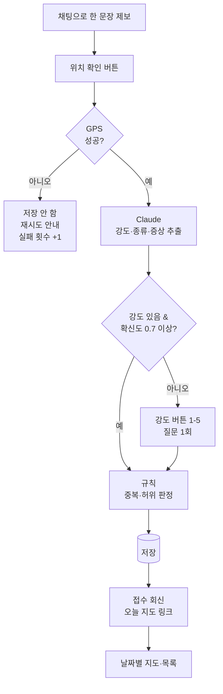

# PRD: 제주숨결봇 (Jeju Breath Bot) - 제주 악취 제보 지도 PoC

- **서비스명:** 제주숨결봇 (영문 Jeju Breath Bot, 저장소·패키지명 `jeju-breath-bot`)
- **문서 목적:** Claude Code로 PoC를 개발하기 위한 요구사항 정의
- **기준:** 2026 제주 환경 해커톤(11/3\~11/4) 팀 결정사항 (브레인스토밍 보드, [파이프라인 기획서](./기획서.md))
- **상태 표기:** [확정] 팀 결정 / [가설] PoC에서 검증할 숫자·기준 / [권장] 구현 편의상 제안, 바꿔도 됨

## 1. 개요

### 1.1 문제

제주 악취 피해 지역 주민은 악취가 반복될 때마다 언제·어디서·얼마나 심했는지 한곳에 기록하거나 확인할 방법이 없다. 기존 창구(120 콜센터, 도 누리집 민원, 악취관리센터 주민참여형 모니터링 앱)는 입력이 번거롭거나 지정 요원에게만 열려 있고, 제보가 하나의 지도에 쌓이지 않는다.

### 1.2 해결

주민이 카카오톡으로 한 문장을 보내면 GPS 위치·시각·강도(1\~5)가 기록되고, 날짜별 지도에서 반복 발생 지역을 확인한다.

### 1.3 PoC 목표

제보 등록 → 날짜별 지도 확인 흐름을 실제로 작동시켜 11/4에 시연한다.

### 1.4 사용자

| 사용자 | 목표 |
| --- | --- |
| 주민(제보자) | 악취가 날 때 1분 안에 제보를 끝낸다 |
| 주민(열람자) | 오늘·특정 날짜에 어디서 악취가 심했는지 지도로 본다 |
| 시연 운영자(팀) | 시연 데이터를 넣고, 장애 시 비상 모드로 전환한다 |

대표 페르소나(가상): 67세 애월읍 주민. 카톡은 쓰지만 위치 권한 설정은 어려워함. 악취가 나면 창문을 닫고 참는다.

## 2. 범위

### 2.1 PoC 범위 (우선순위)

| 우선순위 | 기능 |
| --- | --- |
| P0 (시연 필수) | 제보 수신(채팅), 위치 확인(GPS 필수), AI 강도·냄새 종류 추출, 강도 확인 버튼, 저장, 날짜별 지도·목록, 접수 회신 |
| P1 (시간 남으면) | AI 회신 문구 개선, 중복·허위 '확인 필요' 표시, GPS 실패 익명 집계 표시, 접근성 요소, 마커 상세 팝업 |
| P2 (이후, 구현하지 않음) | 처리 상태 공개, 급증 알림, 지역 분석, AI 자동 신고, 기상·센서 연계, 대리 제보 전용 흐름 |

### 2.2 하지 않음 [확정]

- GPS 없는 제보 저장
- 주소·마을명 직접 입력, 지도 핀 선택으로 위치 받기
- 제보자 이름·연락처 수집
- 원인 추정, 사업장 지목, 법적 판단

## 3. 핵심 정책

### 3.1 위치 정책 [확정]

| 상황 | 제보 저장 | 지도 노출 | 통계 | 남기는 것 |
| --- | --- | --- | --- | --- |
| GPS 있음 | 저장 | 근사 위치 | 포함 | 제보 전체 |
| GPS 없음(거부·실패·타임아웃) | 저장하지 않음, 재시도 안내 | 없음 | 없음 | 날짜별 실패 횟수만 익명 집계 |

- 근사 위치: 약 200m 격자로 반올림해 표시 [가설]
- 유효 범위: 제주도 경계 박스(위도 33.1\~33.6, 경도 126.1\~127.0) 밖이면 실패 처리 [권장]
- 정확도: `coords.accuracy`가 200m 초과면 재시도 안내 [가설]

### 3.2 강도 기준 [확정]

제주 주민참여형 악취모니터링 0\~5도를 준용한다. 0(무취)은 제보 대상이 아니다.

| 강도 | 기준 | 주민 표현 예시 | 지도 색 |
| --- | --- | --- | --- |
| 1 | 감지 취기 | 살짝 냄새나요 | 연노랑 `#FDE68A` |
| 2 | 보통 취기 | 무슨 냄새인지 알겠어요 | 연노랑 `#FDE68A` |
| 3 | 강한 취기 | 냄새가 확 나요 | 주황 `#FB923C` |
| 4 | 극심한 취기 | 창문 닫아야 해요 | 빨강 `#DC2626` |
| 5 | 참기 어려운 취기 | 숨쉬기 힘들어요 | 빨강 `#DC2626` |

색만으로 구분하지 않고 항상 숫자·글자를 함께 표시한다.

### 3.3 냄새 종류

양돈 · 계사 · 우사 · 퇴비 · 액비 · 음식물 · 기타 · 알 수 없음

### 3.4 중복·허위 [가설]

- **중복:** 같은 제보자가 30분 이내·반경 300m 이내에 다시 제보하면 1건으로 묶는다 (나중 제보로 강도 갱신, "중복으로 합쳐졌어요" 안내)
- **허위 의심:** 10분 안에 5km 이상 이동, 또는 1시간 5건 초과 → 저장하되 `needs_review=true`, 지도에서 회색, 통계 제외
- 삭제는 하지 않는다 (운영자 판단 영역)

### 3.5 개인정보 [확정]

- 제보자 식별자는 `SHA-256(salt + 원본 ID)`으로만 저장
- 원문은 저장 전 전화번호·이메일·이름 패턴 마스킹
- 원좌표는 판정 후 격자 좌표만 남기고 삭제 (PoC에서는 `raw_lat`/`raw_lng` 컬럼을 판정 직후 null 처리)
- 지도·목록에 제보자 정보 노출 금지

## 4. 사용자 흐름



## 5. 기능 요구사항

### FR-1 제보 수신 (P0)

- 채팅 UI에서 자유 문장 입력. 예시 칩 3개: "축사 냄새 때문에 창문을 못 열겠어요" / "냄새가 납니다" / "돼지 냄새 때문에 숨 막혀요"
- 수신 시각은 서버 시각(Asia/Seoul)으로 기록
- 빈 문장, 500자 초과는 거절 안내
- **수용 기준:** 문장 전송 후 1초 안에 위치 확인 단계로 넘어간다

### FR-2 위치 확인 (P0)

- 안내: "정확한 지도를 위해 현재 위치가 필요해요" + [위치 허용] 버튼(높이 56px 이상)
- `navigator.geolocation.getCurrentPosition({ enableHighAccuracy: true, timeout: 10000 })`
- 실패 시 안내: "위치를 확인하지 못해 저장하지 않았어요. 밖으로 나가 위치 권한을 켠 뒤 다시 눌러 주세요." + [다시 시도] [가족·이장에게 부탁하는 방법]
- 실패 시 `/api/location-failures`에 날짜만 전송(내용·좌표·식별자 없음)
- 시연 모드: 환경변수 `DEMO_MODE=true`일 때만 [테스트 좌표 사용] 토글 노출. 사용 시 애월읍 테스트 좌표를 쓰고 화면에 "시연 모드: 테스트 좌표" 배지 표시. 운영 빌드에서는 비활성
- **수용 기준:** 권한 거부 시 DB에 제보 행이 생기지 않고 실패 카운트만 +1

### FR-3 AI 추출 (P0)

- Claude API로 강도·냄새 종류·증상·확신도를 JSON으로 추출 (6장 참고)
- 처리 중 안내: "AI가 냄새 강도와 종류를 정리하고 있어요"
- 결과는 JSON이 아니라 카드 문장으로 표시: "강도 4 · 극심 / 냄새 종류: 양돈 / 증상: 창문 닫음"
- **수용 기준:** 평가용 20문장 중 18개 이상 팀 라벨과 강도 일치 [가설]

### FR-4 강도 확인 (P0)

- 조건: `intensity == null` 또는 `confidence < 0.7`
- 질문(고정 문구): "지금 냄새는 몇 단계인가요?" + 버튼 [1 살짝] [2 보통] [3 강함] [4 극심] [5 참기 어려움]
- 질문은 1회만. 버튼 선택값이 최종 강도
- **수용 기준:** "냄새가 납니다" 입력 시 반드시 버튼 질문이 나온다

### FR-5 검증·저장 (P0, 판정은 P1)

- 3.4 규칙 적용 후 저장
- **수용 기준:** 같은 사용자 해시로 30분 내 300m 내 두 번 제보 시 1건만 남는다

### FR-6 접수 회신 (P0)

- "제보가 접수됐어요" + 시각·강도·냄새 종류 + "오늘 주변 제보 n건" + [오늘 지도 보기]
- 안전 문구: "이 정보는 주민 제보 기준이며 원인이나 책임을 판단하지 않아요. 건강 이상이 있으면 119 또는 의료기관에 문의하세요."
- 회신 문장은 Claude가 2문장 이내로 생성(P1). P0은 고정 템플릿

### FR-7 날짜별 지도·목록 (P0)

- 날짜 선택(최근 7일), [지도]/[목록] 탭, 제목 "날짜별 악취 제보 지도 (제보 기준)"
- 지도: Leaflet + OpenStreetMap 타일 [권장], 애월읍 중심, 격자 좌표로 원형 마커, 마커 안에 강도 숫자
- 마커 클릭 시 상세: 시각·강도·냄새 종류·증상 (P1)
- 하단 요약: "오늘 제보 n건 · 강도 4 이상 n건 · 위치 실패 n회(저장 안 함)"
- `needs_review` 제보는 회색, 요약 집계 제외
- 지도 타일 로딩 실패 시 목록 탭으로 자동 전환
- **수용 기준:** 시드 데이터 20건이 실제 위도·경도 위치에 표시된다

### FR-8 시드 데이터 (P0)

- 가상 제보 20건: 같은 날 한 마을(애월읍 일대)에 아침(06\~09시)·저녁(19\~23시) 몰린 급증 상황 포함, 냄새 종류는 양돈 위주
- 모든 시드 데이터는 `is_demo=true`, 화면에 "시연 모드: 가상 데이터" 배지

## 6. AI 명세

### 6.1 모델 [확정]

- Anthropic Claude API, 모델 `claude-haiku-5-5` (Claude Haiku 5.5)
- 키는 서버 환경변수 `ANTHROPIC_API_KEY`에만 보관, 브라우저로 노출 금지

### 6.2 추출 호출

- tool use로 출력 형식 고정. 도구 이름 `record_odor_report`, `tool_choice`로 해당 도구 강제
- 입력 스키마:

```json
{
  "type": "object",
  "properties": {
    "intensity": { "type": ["integer", "null"], "minimum": 1, "maximum": 5 },
    "odor_type": { "type": "string", "enum": ["양돈","계사","우사","퇴비","액비","음식물","기타","알 수 없음"] },
    "symptoms": { "type": "array", "items": { "type": "string" } },
    "confidence": { "type": "number", "minimum": 0, "maximum": 1 }
  },
  "required": ["intensity", "odor_type", "symptoms", "confidence"]
}
```

- 시스템 프롬프트 요지:
  - 너는 제주 주민의 악취 제보 문장을 구조화한다
  - 3.2 강도 기준표와 예시를 따른다. 강도 표현이 없으면 `intensity`는 null
  - 원인이나 책임 사업장을 추정하지 않는다
  - few-shot 예시 5개 포함 (아래 6.4에서 선택)
- `max_tokens` 1024, `output_config.effort` `low`. `temperature`는 보내지 않음 (Haiku 5.5는 기본값 외 sampling 값을 400으로 거절)
- 안전 분류기가 거절하면(`stop_reason: "refusal"`) FR-4 버튼 질문으로 전환

### 6.3 실패 처리

| 상황 | 처리 |
| --- | --- |
| 스키마 불일치·범위 밖 값 | 1회 재시도, 다시 실패하면 FR-4 버튼 질문 |
| API 오류·5초 초과 | 즉시 FR-4 버튼 질문, 냄새 종류 '알 수 없음' |
| 회신 생성 결과에 원인 추정·법적 판단 단어 | 고정 템플릿으로 대체 |

### 6.4 평가 데이터

- 팀 작성 문장 60개(강도 1\~5 각 10개 + 강도 없음 10개). 40개는 프롬프트 조정용, 20개는 평가용
- `eval/sentences.json` 형식: `{ "text": "...", "intensity": 4 | null, "odor_type": "양돈" }`
- `npm run eval`로 평가용 20개 일치율 출력
- 예시:

| 문장 | 강도 | 냄새 종류 |
| --- | --- | --- |
| 살짝 냄새가 나네요 | 1 | |
| 돼지 냄새인 걸 알겠어요 | 2 | 양돈 |
| 축사 냄새가 확 올라와요 | 3 | |
| 축사 냄새 때문에 창문을 못 열겠어요 | 4 | |
| 숨을 못 쉬겠어요 | 5 | |
| 냄새가 납니다 | null | |

## 7. 데이터 모델 [PostgreSQL]

```sql
CREATE TABLE reports (
  id            SERIAL PRIMARY KEY,
  user_hash     TEXT NOT NULL,
  text_masked   TEXT NOT NULL,
  intensity     INTEGER NOT NULL CHECK (intensity BETWEEN 1 AND 5),
  intensity_src TEXT NOT NULL CHECK (intensity_src IN ('ai','button')),
  odor_type     TEXT NOT NULL,
  symptoms      JSONB NOT NULL DEFAULT '[]',
  confidence    DOUBLE PRECISION,
  grid_lat      DOUBLE PRECISION NOT NULL,
  grid_lng      DOUBLE PRECISION NOT NULL,
  raw_lat       DOUBLE PRECISION,              -- 판정 직후 NULL 처리
  raw_lng       DOUBLE PRECISION,
  needs_review  BOOLEAN NOT NULL DEFAULT FALSE,
  merged_count  INTEGER NOT NULL DEFAULT 1,
  is_demo       BOOLEAN NOT NULL DEFAULT FALSE,
  reported_at   TIMESTAMPTZ NOT NULL           -- 날짜 구분은 Asia/Seoul 기준
);
CREATE INDEX idx_reports_date ON reports (reported_at);

-- 사진 파일은 MinIO(S3 호환) 비공개 버킷에, DB에는 객체 키만
CREATE TABLE report_photos (
  id          SERIAL PRIMARY KEY,
  report_id   INTEGER NOT NULL REFERENCES reports(id) ON DELETE CASCADE,
  object_key  TEXT NOT NULL UNIQUE,            -- reports/YYYY-MM-DD/<uuid>.jpg
  bytes       INTEGER NOT NULL,
  uploaded    BOOLEAN NOT NULL DEFAULT FALSE,   -- 업로드 완료 후 TRUE, 그 전에는 공개하지 않음
  created_at  TIMESTAMPTZ NOT NULL DEFAULT now()
);

-- 카카오 스킬이 받은 문장 (9.2). 링크의 token으로만 열고, 30분 안에 한 번만 쓴다.
CREATE TABLE kakao_drafts (
  token       TEXT PRIMARY KEY,                -- randomBytes(16) base64url, 링크에만 들어감
  user_hash   TEXT NOT NULL,                   -- hashUserId("kakao:" + botUserKey). 원래 키는 저장하지 않음
  text_masked TEXT NOT NULL,                   -- 개인정보 마스킹한 문장
  created_at  TIMESTAMPTZ NOT NULL DEFAULT now(),
  used_at     TIMESTAMPTZ                      -- 저장 성공 시 같은 트랜잭션에서 기록
);

CREATE TABLE location_failures (
  day   TEXT PRIMARY KEY,                      -- YYYY-MM-DD
  count INTEGER NOT NULL DEFAULT 0
);
```

사진 (선택, 제보당 최대 3장, 원본 10MB 이하):

- 휴대폰에서 긴 변 1600px로 줄여 보내고, 서버가 긴 변 1280px JPEG로 다시 인코딩하며 EXIF(촬영 위치·기기 정보)를 모두 지운다.
- 버킷은 비공개. 지도·목록은 `/api/photos/{id}`로만 보며, 확인 필요 제보의 사진은 내보내지 않는다.
- 사진 저장이 실패해도 제보는 저장한다.
- 촬영 안내: 사람 얼굴·차 번호판·집 안이 나오지 않게.

보관 기간(운영 시): 원문 30일 후 삭제, 원좌표는 판정 직후 삭제, 시연 데이터는 해커톤 종료 1주 후 전체 삭제.

## 8. API

| 메서드 | 경로 | 설명 |
| --- | --- | --- |
| POST | `/api/reports/extract` | `{ text }` → AI 추출 결과 `{ intensity, odor_type, symptoms, confidence, needs_question }` |
| POST | `/api/reports` | `{ user_id, text, lat, lng, accuracy, intensity, intensity_src, odor_type, symptoms, confidence }` → 검증·저장 → `{ id, merged, needs_review, today_nearby_count, photo }`. lat/lng 없으면 400. 카카오 링크에서 온 제보는 `draft_token`을 함께 보내며(`user_id`·`text`는 무시, 서버의 초안 값 사용), 초안이 없거나 만료·사용됐으면 410 `{ error }`. 위치 실패(422)·400은 초안을 소비하지 않음. 사진을 붙이면 multipart (`data`: 위 JSON 문자열, `photo`: 이미지) |
| GET | `/api/photos/{id}` | 공개 가능한 제보 사진 (확인 필요 제보는 404) |
| POST | `/api/location-failures` | 본문 없음. 오늘 날짜 카운트 +1 |
| GET | `/api/reports?date=YYYY-MM-DD` | 해당 날짜 제보 목록(격자 좌표만, `user_hash` 제외, `photo_ids` 포함) |
| GET | `/api/summary?date=YYYY-MM-DD` | `{ total, high_intensity, location_failures }` |
| POST | `/api/kakao/skill` | (P1) 카카오 오픈빌더 스킬. `x-skill-secret` 헤더 필수(없거나 틀리면 401, 서버에 `KAKAO_SKILL_SECRET`이 없으면 503). 문장을 마스킹해 초안으로 저장하고 `textCard`(웹링크 버튼)로 회신. AI는 부르지 않음. 9.2 참고 |

PoC의 `user_id`는 브라우저 localStorage에 만든 랜덤 UUID. 서버에서 해시 후 저장, 원본은 저장하지 않는다.

## 9. 기술 구성

### 9.1 스택 [권장]

- 저장소·패키지명: `jeju-breath-bot`
- Next.js(App Router) + TypeScript, 단일 저장소
- DB: PostgreSQL (`pg`), 테스트는 PGlite
- 사진: MinIO (`@aws-sdk/client-s3`), 재인코딩·EXIF 제거는 `sharp`
- 지도: Leaflet + OpenStreetMap 타일
- AI: `@anthropic-ai/sdk`
- 테스트: Vitest (규칙 판정 단위 테스트), 평가 스크립트

### 9.2 카카오톡 연동 (P1, 기술 위험)

- 시연의 기본 경로는 웹 채팅 화면(카톡 대화 스타일)으로 한다. 카카오 채널 개설·오픈빌더 스킬 연결은 승인·설정 시간이 불확실하므로 P1
- 연동 시: 오픈빌더 스킬이 문장을 받으면 [위치 확인하고 제보하기] 웹 링크 버튼으로 회신 → 웹 페이지에서 브라우저 위치를 받아 같은 `/api/reports`로 저장
- 확인 필요: 챗봇 메시지만으로 기기 GPS를 받을 수 있는지, 스킬 응답 시간 제한과 AI 호출 시간. 11/3 저녁에 실제 기기로 시험

구현 (`lib/kakao.ts`, `app/api/kakao/skill/route.ts`):

1. 스킬은 5초 제한 때문에 AI를 부르지 않는다. 발화(500자 이내)를 마스킹해 `kakao_drafts`에 저장하고 token을 만든다. 비었거나 500자를 넘으면 `simpleText`로 안내만 한다.
2. 회신은 `textCard`: 마스킹한 문장 인용 + 안내, 버튼 [위치 확인하고 제보하기](`${PUBLIC_BASE_URL}/report?d=<token>`)와 [오늘 지도 보기](`/map`). 링크에는 token만 들어가고 문장은 없다.
3. `/report?d=<token>`: 서버가 초안을 확인해 문장을 채운 채 '위치 확인' 단계부터 시작하고, 이후는 기존 흐름(AI 추출 → 필요하면 강도 질문 → 저장)이다. `report_started`는 스킬이 센다. 만료된 링크면 입력 화면에 안내를 보인다. 사진은 입력 단계에만 있어 카카오 경로에서는 붙이지 않는다.
4. 저장 시 제보자는 `hashUserId("kakao:" + botUserKey)`, 문장은 초안 값을 쓴다. 초안은 저장과 같은 트랜잭션에서 사용 처리(`used_at`)해 두 번 쓸 수 없다. 유효기간 30분, 하루 지난 초안은 스킬 호출 때 삭제한다. botUserKey 원문은 저장하지 않는다.
5. 보안: 스킬 요청은 `X-Skill-Secret` 헤더가 `KAKAO_SKILL_SECRET`과 같아야 한다(상수 시간 비교). 발화·사용자 키는 로그에 남기지 않는다.

오픈빌더 설정: 스킬 URL `https://<배포주소>/api/kakao/skill`, 헤더 `X-Skill-Secret: <KAKAO_SKILL_SECRET 값>`, 메소드 POST. 폴백 블록(또는 모든 발화)의 봇 응답을 이 스킬로 연결하고 스킬데이터 사용으로 설정한다.

### 9.3 환경변수

```
ANTHROPIC_API_KEY=
USER_HASH_SALT=
DEMO_MODE=true
KAKAO_SKILL_SECRET=   # 오픈빌더 스킬 호출 비밀 헤더 값. 비어 있으면 스킬이 503
PUBLIC_BASE_URL=      # 카카오 링크의 바탕 주소 (https://<배포주소>). 없으면 요청 주소
```

### 9.4 디렉터리 [권장]

```
app/
  page.tsx              # 시작
  report/page.tsx       # 채팅 제보 + 위치 + 강도 확인 + 접수
  map/page.tsx          # 날짜별 지도·목록
  api/...               # 8장 API
lib/
  claude.ts             # 추출·회신 호출, 실패 처리
  rules.ts              # 격자 반올림, 중복·허위 판정, 제주 범위 검사
  mask.ts               # 개인정보 마스킹
  db.ts
scripts/seed.ts         # 시드 20건
eval/sentences.json
eval/run.ts
```

## 10. 화면 요구사항

공통: 모바일 우선, 본문 18px 이상, 버튼 높이 56px 이상, 한 화면 한 단계, "\~해요"체, 상단 로고(제주 오름 + 바람 심볼) 반복, 같은 심볼의 파비콘·홈 화면 아이콘, 시연 모드 배지.

| 화면 | 제목·안내 | 입력 | 버튼 | 결과 |
| --- | --- | --- | --- | --- |
| 시작 | "악취가 나면 한 문장으로 알려주세요" | 없음 | [제보하기] [오늘 지도 보기] | |
| 제보(채팅) | "지금 느끼는 냄새를 한 문장으로 보내 주세요" | 자유 문장, 예시 칩 3개 | [보내기] | 위치 확인으로 |
| 위치 확인 | "정확한 지도를 위해 현재 위치가 필요해요" | 브라우저 위치 권한 | [위치 허용] | 성공 시 AI 처리로 |
| AI 처리 | "AI가 냄새 강도와 종류를 정리하고 있어요" | 없음 | 없음 | 결과 카드 |
| 강도 확인 | "지금 냄새는 몇 단계인가요?" | 없음 | [1 살짝] \~ [5 참기 어려움] | 강도 확정 |
| 접수 완료 | "제보가 접수됐어요" | 없음 | [오늘 지도 보기] | 시각·강도·종류·주변 n건, 안전 문구 |
| 오류 안내 | "위치를 확인하지 못해 저장하지 않았어요" | 없음 | [다시 시도] [가족·이장에게 부탁하는 방법] | |
| 지도·목록 | "날짜별 악취 제보 지도 (제보 기준)" | 날짜 선택 | [지도] [목록] | 마커·범례·요약 줄 |

## 11. 비기능 요구사항

- 제보 완료까지 1분 이내(문장 입력 시간 제외 20초 이내) [가설]
- Claude 추출 응답 5초 초과 시 버튼 질문으로 전환
- API 키·salt는 서버에만, 클라이언트 번들 검사로 확인
- 로그에 원문·좌표·사용자 ID를 남기지 않는다

## 12. PoC 성공 지표 [가설]

| 지표 | 목표 | 측정 | 미달 시 |
| --- | --- | --- | --- |
| 제보 완료율 | 시도 대비 80% | 서버 로그(시작/저장) | 질문 단계 축소 |
| GPS 허용률 | 80% 이상 | 1 - 실패 횟수 ÷ 시도 | 저장 안 함 유지, 안내 문구 개선·대리 제보 안내 |
| 지도 열람률 | 접수 후 50% | 지도 진입 로그 | 접수 화면에 지도 요약 이미지 |
| AI 강도 정확도 | 평가 20문장 중 18개 | `npm run eval` | 프롬프트 예시 보강, 버튼 비중 확대 |

## 13. 시연 시나리오 (11/4, 약 3분)

1. 문제 소개 (30초)
2. 주민 A: "축사 냄새 때문에 창문을 못 열겠어요" → 위치 허용 → 강도 4 자동 → 접수 → 지도
3. 주민 B: "냄새가 납니다" → 강도 버튼 질문 → 3 선택 → 저장
4. 주민 C: 위치 거부 → 저장 안 함 안내, 요약 줄의 위치 실패 1회 증가
5. 시드 20건과 함께 날짜별 지도: 강도 4\~5 빨간 마커가 한 마을에 몰린 모습
6. 지표와 다음 단계(기관 협의, 확장)

## 14. 시연 비상안

| 문제 | 비상안 |
| --- | --- |
| 위치 연동 실패 | `DEMO_MODE` 테스트 좌표 토글 (배지 표시) |
| Claude API 장애 | 버튼 질문만으로 제보 |
| 카카오 연동 미완 | 웹 채팅 화면으로 시연 (기본 경로) |
| 지도 타일 실패 | 목록 탭 + 미리 캡처한 지도 이미지 |

## 15. 개발 순서 (Claude Code 작업 단위)

1. 프로젝트 생성, DB 스키마, `lib/rules.ts` + 단위 테스트(격자, 중복, 허위, 제주 범위)
2. `scripts/seed.ts` 시드 20건, `GET /api/reports`, `/api/summary`
3. 지도·목록 화면 (FR-7)
4. `lib/claude.ts` 추출 + 실패 처리, `/api/reports/extract`, `eval/run.ts`
5. 채팅 제보 → 위치 → 강도 확인 → 접수 화면 (FR-1\~6), 위치 실패 집계
6. 시연 모드, 비상안, 접근성 점검
7. (P1) 마커 상세, 회신 생성, 카카오 스킬

각 단계 완료 기준: 해당 FR의 수용 기준 통과 + `npm test` 통과.

## 16. 미결 사항

- 카톡 챗봇에서 위치를 받는 실제 방식과 스킬 응답 시간 (9.2)
- 중복·허위 숫자 기준, 근사 위치 격자 크기, 정확도 기준 (PoC 후 조정)
- 운영 주체·처리 상태 갱신 담당 (해커톤 이후 기관 협의)
- 팀 역할 확정 ([기획서](./기획서.md) 5장 제안)

## 17. 참고

- 제주악취관리센터, 주민참여형 악취모니터링 (강도 0\~5도 기준): https://www.jomc.co.kr/monitoring/citizen
- 제주악취관리센터, 2021년 주민참여형 악취모니터링 시스템 운영 결과보고서
- 제주특별자치도 민원신청/신고센터 (120 만덕콜센터): https://www.jeju.go.kr/online.htm
