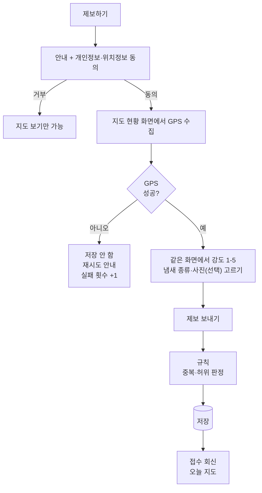

# PRD: 제주숨결봇 (Jeju Breath Bot) - 제주 악취 제보 지도 PoC

- **서비스명:** 제주숨결봇 (영문 Jeju Breath Bot, 저장소·패키지명 `jeju-breath-bot`)
- **문서 목적:** Claude Code로 PoC를 개발하기 위한 요구사항 정의
- **기준:** 2026 제주 환경 해커톤(11/3\~11/4) 팀 결정사항 (브레인스토밍 보드, [파이프라인 기획서](./기획서.md))
- **상태 표기:** [확정] 팀 결정 / [가설] PoC에서 검증할 숫자·기준 / [권장] 구현 편의상 제안, 바꿔도 됨

## 1. 개요

### 1.1 문제

제주 악취 피해 지역 주민은 악취가 반복될 때마다 언제·어디서·얼마나 심했는지 한곳에 기록하거나 확인할 방법이 없다. 기존 창구(120 콜센터, 도 누리집 민원, 악취관리센터 주민참여형 모니터링 앱)는 입력이 번거롭거나 지정 요원에게만 열려 있고, 제보가 하나의 지도에 쌓이지 않는다.

### 1.2 해결

주민이 [제보하기]를 눌러 동의한 뒤, 지도 화면에서 GPS 위치를 받고 냄새 세기(1\~5)·종류를 버튼으로 고르면 위치·시각·강도가 기록되고, 날짜별 지도에서 반복 발생 지역을 확인한다.

### 1.3 PoC 목표

제보 등록 → 날짜별 지도 확인 흐름을 실제로 작동시켜 11/4에 시연한다.

### 1.4 사용자

| 사용자 | 목표 |
| --- | --- |
| 주민(제보자) | 악취가 날 때 1분 안에 제보를 끝낸다 |
| 주민(열람자) | 오늘·특정 날짜에 어디서 악취가 심했는지 지도로 본다 |
| 시연 운영자(팀) | 시연 데이터를 넣고, 장애 시 비상 모드로 전환한다 |

대표 페르소나(가상): 67세 애월읍 주민. 카톡은 쓰지만 위치 권한 설정은 어려워함. 악취가 나면 창문을 닫고 참는다.

## 2. 범위

### 2.1 PoC 범위 (우선순위)

| 우선순위 | 기능 |
| --- | --- |
| P0 (시연 필수) | 제보 시작·개인정보 동의, 위치 확인(GPS 필수), 강도·냄새 종류 버튼 선택, 사진(선택), 저장, 날짜별 지도·목록, 접수 회신 |
| P1 (시간 남으면) | 중복·허위 '확인 필요' 표시, GPS 실패 익명 집계 표시, 접근성 요소, 마커 상세 팝업 |
| P2 (이후, 구현하지 않음) | 처리 상태 공개, 급증 알림, 지역 분석, AI 자동 신고, 기상·센서 연계, 대리 제보 전용 흐름 |

### 2.2 하지 않음 [확정]

- GPS 없는 제보 저장
- 주소·마을명 직접 입력, 지도 핀 선택으로 위치 받기
- 제보자 이름·연락처 수집
- 자연어(문장) 제보와 AI 추출 (2026-11-03 결정: 버튼 선택으로 대체, 6장)
- 원인 추정, 사업장 지목, 법적 판단

## 3. 핵심 정책

### 3.1 위치 정책 [확정]

| 상황 | 제보 저장 | 지도 노출 | 통계 | 남기는 것 |
| --- | --- | --- | --- | --- |
| GPS 있음 | 저장 | 근사 위치 | 포함 | 제보 전체 |
| GPS 없음(거부·실패·타임아웃) | 저장하지 않음, 재시도 안내 | 없음 | 없음 | 날짜별 실패 횟수만 익명 집계 |

- 근사 위치: 약 200m 격자로 반올림해 표시 [가설]
- 유효 범위: 제주도 경계 박스(위도 33.1\~33.6, 경도 126.1\~127.0) 밖이면 실패 처리 [권장]
- 정확도: `coords.accuracy`가 200m 초과면 재시도 안내 [가설]

### 3.2 강도 기준 [확정]

제주 주민참여형 악취모니터링 0\~5도를 준용한다. 0(무취)은 제보 대상이 아니다.

| 강도 | 기준 | 화면 문구 | 지도 색 (글자색) |
| --- | --- | --- | --- |
| 1 | 감지 취기 | **살짝 나요** · 냄새가 나는 걸 겨우 알겠어요 | 초록 `#15803D` (흰색) |
| 2 | 보통 취기 | **냄새가 나요** · 무슨 냄새인지 알겠어요 | 노랑 `#FACC15` (`#1F2A2E`) |
| 3 | 강한 취기 | **심해요** · 냄새가 확 느껴져요 | 연주황 `#FDBA74` (`#1F2A2E`) |
| 4 | 극심한 취기 | **아주 심해요** · 창문을 닫아야 할 정도예요 | 주황 `#C2410C` (흰색) |
| 5 | 참기 어려운 취기 | **못 참겠어요** · 숨쉬기 힘들 정도예요 | 빨강 `#DC2626` (흰색) |

기준 열은 악취방지법상 용어이고, 화면에는 '화면 문구'를 쓴다. 글자색 대비는 모두 4.5:1 이상이다.

색만으로 구분하지 않고 항상 숫자·글자를 함께 표시한다.

### 3.3 냄새 종류

양돈 · 계사 · 우사 · 퇴비 · 액비 · 음식물 · 기타 · 알 수 없음

### 3.4 중복·허위 [가설]

- **중복:** 같은 제보자가 30분 이내·반경 300m 이내에 다시 제보하면 1건으로 묶는다 (나중 제보로 강도 갱신, "중복으로 합쳐졌어요" 안내)
- **허위 의심:** 10분 안에 5km 이상 이동, 또는 1시간 5건 초과 → 저장하되 `needs_review=true`, 지도에서 회색, 통계 제외
- 삭제는 하지 않는다 (운영자 판단 영역)

### 3.5 개인정보 [확정]

- 제보자 식별자는 `SHA-256(salt + 원본 ID)`으로만 저장
- 문장은 받지 않는다 (자유 입력 없음)
- 원좌표는 판정 후 격자 좌표만 남기고 삭제 (PoC에서는 `raw_lat`/`raw_lng` 컬럼을 판정 직후 null 처리)
- 지도·목록에 제보자 정보 노출 금지
- 제보 전에 개인정보·위치정보 수집·이용 동의를 받는다 (3.6)

### 3.6 개인정보·위치정보 동의 [확정]

[제보하기]를 누르면 제보 화면 전에 안내와 동의 단계를 거친다. 동의해야 위치를 요청하고 제보를 보낼 수 있다. 동의 문구에는 아래 항목을 쉬운 말로 담는다.

| 항목 | 내용 |
| --- | --- |
| 수집 항목 | 위치: 약 200m 단위로 바꿔 저장하고, 정확한 좌표는 판정 직후 삭제 / 제보 시각 / 냄새 세기·종류 / 사진(선택, 촬영 정보를 지운 뒤 지도에 공개) / 기기 임의 번호(해시, 중복 판단용) |
| 이용 목적 | 날짜별 악취 제보 지도 표시, 같은 사람의 중복·허위 제보 판단, 통계 |
| 보관 기간 | 시범 운영 종료 후 1주 안에 삭제 |
| 거부 권리 | 동의하지 않아도 지도 보기는 쓸 수 있다. 거부하면 제보는 할 수 없다 |
| 동의 버전 | 문구를 바꾸면 `lib/types.ts`의 `CONSENT_VERSION`(날짜)을 올린다. 제보마다 `consent_version`을 저장하고, 서버는 현재 버전과 다르면 400으로 거절한다 |

## 4. 사용자 흐름



## 5. 기능 요구사항

### FR-1 제보 시작·동의 (P0)

- [제보하기] → 안내 + 개인정보·위치정보 동의(3.6). 동의해야 다음으로 간다. 거부하면 지도 보기만 가능
- 제보를 시작하면 화면이 `/api/events`로 `report_started`를 보낸다
- 수신 시각은 서버 시각(Asia/Seoul)으로 기록
- **수용 기준:** `consent_version`이 없거나 현재 버전과 다르면 서버가 400 "개인정보·위치정보 동의가 필요해요."로 거절하고 행이 생기지 않는다

### FR-2 위치 확인 (P0)

- 지도 현황 화면에서 위치를 받는다. 안내: "정확한 지도를 위해 현재 위치가 필요해요" + [위치 허용] 버튼(높이 56px 이상)
- `navigator.geolocation.getCurrentPosition({ enableHighAccuracy: true, timeout: 10000 })`
- 실패 시 안내: "위치를 확인하지 못해 저장하지 않았어요. 밖으로 나가 위치 권한을 켠 뒤 다시 눌러 주세요." + [다시 시도] [가족·이장에게 부탁하는 방법]
- 실패 시 `/api/location-failures`에 날짜만 전송(내용·좌표·식별자 없음)
- 시연 모드: 환경변수 `DEMO_MODE=true`일 때만 [테스트 좌표 사용] 토글 노출. 사용 시 애월읍 테스트 좌표를 쓰고 화면에 "시연 모드: 테스트 좌표" 배지 표시. 운영 빌드에서는 비활성
- **수용 기준:** 권한 거부 시 DB에 제보 행이 생기지 않고 실패 카운트만 +1

### FR-3 강도·냄새 종류 선택 (P0)

- 같은 화면에서 강도 버튼(색이 다른 알약 모양 5개, 3.2의 화면 문구)과 냄새 종류 버튼(3.3)을 고른다. 강도는 필수, 종류를 고르지 않으면 '알 수 없음'
- 선택값이 그대로 최종 값이다 (`intensity_src`는 항상 `button`)
- **수용 기준:** 강도 없이는 [제보 보내기]를 누를 수 없고, 서버도 1\~5 정수가 아니면 400
- 강도 5를 고르면 119 전화 안내와 [119에 전화하기](tel:119) 버튼을 보여 주고, 강도 5로 접수되면 접수 화면에도 보여 준다. 자동으로 걸지 않는다.

### FR-4 사진 (선택, P1)

- 제보에 사진을 붙일 수 있다 (7장 사진 규칙). 사진 처리가 실패해도 제보는 저장한다

### FR-5 검증·저장 (P0, 판정은 P1)

- 3.4 규칙 적용 후 저장. 같은 제보자의 병합은 나중 제보의 강도·종류로 갱신
- **수용 기준:** 같은 사용자 해시로 30분 내 300m 내 두 번 제보 시 1건만 남는다

### FR-6 접수 회신 (P0)

- "제보가 접수됐어요" + 시각·강도·냄새 종류 + "오늘 주변 제보 n건" + [오늘 지도 보기]
- 안전 문구: "이 정보는 주민 제보 기준이며 원인이나 책임을 판단하지 않아요. 건강 이상이 있으면 119 또는 의료기관에 문의하세요."
- 회신 문장은 고정 템플릿

### FR-7 날짜별 지도·목록 (P0)

- 날짜 선택(최근 7일), [지도]/[목록] 탭, 제목 "날짜별 악취 제보 지도 (제보 기준)"
- 지도: 카카오맵 [기본, `KAKAO_JS_KEY`], 실패·키 없음이면 Leaflet + OpenStreetMap 타일, 애월읍 중심, 격자 좌표로 원형 마커, 마커 안에 강도 숫자
- 마커 클릭 시 상세: 시각·강도·냄새 종류·증상 (P1)
- 하단 요약: "오늘 제보 n건 · 강도 4 이상 n건 · 위치 실패 n회(저장 안 함)"
- `needs_review` 제보는 회색, 요약 집계 제외
- 지도 타일 로딩 실패 시 목록 탭으로 자동 전환
- **수용 기준:** 시드 데이터 20건이 실제 위도·경도 위치에 표시된다

### FR-9 대기 정보 겹쳐 보기 (P1)

- 출처: 제주특별자치도 보건환경연구원 OpenAPI '제주 대기환경 정보'(인증키 없음, XML). 서버(`/api/air`)가 하루치를 받아 측정소별 최신 시각 값만 내보내고, 10분 동안 캐시한다.
- `/map`과 `/report` 지도에 측정소 12곳을 둥근 사각형 배지로 표시한다. 배지에는 통합대기 등급을 쓰고 색을 입힌다 (좋음·보통·나쁨·매우나쁨).
  - 제보 마커보다 아래 층에 그린다.
  - [대기 정보 보기]로 켜고 끈다 (기본 켜짐).
- 팝업에는 측정 시각, 통합대기 등급, PM10, PM2.5, 오존, 출처를 보여 준다.
- 대표 등급(`REP_CAI`)이 비면 측정된 모든 항목 등급 중 가장 나쁜 값을 쓴다 (통합대기지수 정의).
- 측정소 좌표는 API에 없어서 보건환경연구원 측정소 정보의 주소를 카카오 주소 검색으로 좌표화해 코드에 넣어 둔다 (`lib/air.ts`). 위치를 정확히 찾지 못한 측정소가 생기면 `approx`로 표시해 팝업에 '대략 위치'를 붙인다.
- 외부 API가 실패해도 지도와 제보는 정상 동작하고, "대기 정보를 불러오지 못했어요"만 표시한다.
- `/report` 지도의 내 위치 파란 점 위에 대기(등급 색 원 + 표정 이모지)·바람(청록 원 + 불어 가는 쪽 화살표, 풍속) 아이콘 두 개를 알약 안에 보여 준다. 각각 가장 가까운 측정소·날씨 지점 값이고, 누르면 "내 위치 · 대기 보통 / 동풍 4.4m/s · 냄새는 서쪽으로 / 애월 측정소 기준 · 기상청 09:00" 설명이 펼쳐진다(기본 접힘). [대기 정보 보기]·[날씨 보기]가 꺼지면 해당 아이콘이 빠지고 둘 다 없으면 숨긴다. 제보 마커보다 위, 팝업보다 아래 층.
- `/map`은 지도 왼쪽 위에 같은 아이콘 카드("지도 가운데")를 두고, 지도 이동·확대가 끝날 때마다 가운데 좌표 기준 가장 가까운 지점으로 다시 계산한다. 지난 날짜는 날씨가 없어 대기만 보인다.
- 가이드에는 있지만 실제 응답에 없는 풍향·풍속·기온·습도는 표시하지 않는다. 바람 정보는 별도 출처(기상청)가 필요하다.

### FR-11 날씨(바람) 겹쳐 보기 (P1)

- 출처: 기상청 API허브 초단기실황(`KMA_AUTH_KEY`, 선택). 서버(`/api/weather`)가 대기 측정소 12곳의 위경도를 기상청 격자(LCC 변환)로 바꿔 같은 격자는 한 번만 부르고(병렬, 개별 5초 타임아웃) 기온·습도·풍속·풍향·강수 형태·1시간 강수량을 얻는다. 기준 시각은 서울 시각에서 40분을 뺀 정시(HH00). 키가 없거나 지점 하나라도 실패하면 출처를 섞지 않고 통째로 Open-Meteo(인증키 없음)로 대체한다. 최종 결과를 10분 캐시하므로 활용신청 승인 뒤 최대 10분 안에 기상청으로 바뀐다. 응답 `source`는 `"기상청"` 또는 `"Open-Meteo"`이고 화면에는 "기상청 초단기실황"처럼 표시한다. 초단기실황에는 하늘(SKY)이 없어 하늘 상태는 강수 형태(비·눈·강수 없음 등)로 보인다. 1시간 강수량이 0보다 크면 팝업에 "1시간 강수 2mm"를 더한다. 출처 관련 코드는 `lib/weather.ts`에 모아 두었다.
- `/map`과 `/report` 지도에 지점마다 바람 화살표(반투명 흰 원 + 청록 화살표 + 풍속)를 측정소 배지 오른쪽 위에 표시한다. 화살표는 바람이 불어 가는 쪽(냄새가 퍼질 수 있는 쪽)을 가리키고, 제보 마커보다 아래 층에 그린다. 지도 맞춤은 제보·내 위치 기준 그대로다.
- 팝업: "북동풍 3.2m/s — 냄새는 남서쪽으로 퍼질 수 있어요"(0.5m/s 미만이면 "바람이 거의 없어 냄새가 머물 수 있어요"), 기온, 습도, 하늘 상태, 출처·기준 시각. 원인이나 책임을 판단하는 표현은 쓰지 않는다.
- 지도 위 한 줄 요약 "지금 바람: 북동풍 3m/s · 12℃ · 습도 70% (애월 기준)". 기준 지점은 `/report`는 내 위치에서 가장 가까운 지점(위치 전이면 애월), `/map`은 애월.
- [날씨 보기]로 켜고 끈다 (기본 켜짐, 브라우저에 기억). 현재 날씨만 있으므로 오늘 날짜일 때만 불러오고, 지난 날짜를 보면 "날씨는 오늘만 보여요"라고 알린다.
- 외부 API가 실패해도 지도와 제보는 정상 동작하고, "날씨 정보를 불러오지 못했어요"만 표시한다.

### FR-10 통계 페이지 (P1)

- `/stats`: 기간(오늘·최근 7일·최근 30일)을 고르면 제보 건수·강도 4 이상·같은 곳 다시 제보(합쳐짐)·위치 실패 타일과 차트를 보여 준다. 숫자만 집계하며 위치·제보자 정보는 없다.
- 차트: 날짜별(강도별로 쌓은 막대, 오늘 기간은 숨김), 시간대별(서울 시각), 강도별, 냄새 종류, 참여 지표(시작→저장→지도 열람, 완료율·위치 허용률·지도 열람률). 각 차트는 hover·focus 툴팁과 `표로 보기` 표를 갖는다.
- `needs_review` 제보는 모든 집계에서 빼고 개수만 따로 안내한다. 시연 데이터가 있으면 "시연 모드: 가상 데이터" 배지.
- 진입: 홈 [통계 보기], `/map` 아래 링크.

### FR-8 시드 데이터 (P0)

- 가상 제보 20건: 같은 날 한 마을(애월읍 일대)에 아침(06\~09시)·저녁(19\~23시) 몰린 급증 상황 포함, 냄새 종류는 양돈 위주
- 모든 시드 데이터는 `is_demo=true`, 화면에 "시연 모드: 가상 데이터" 배지

## 6. AI 명세 (제거됨)

제거됨 (2026-11-03 결정: 자연어 제보 대신 버튼 선택). 문장 입력, Claude 추출, 강도 확신도 질문, 평가 스크립트(`npm run eval`), `ANTHROPIC_API_KEY`를 모두 없앴다. 강도와 냄새 종류는 주민이 버튼으로 직접 고른다. 문장을 받지 않으므로 개인정보 마스킹 코드도 없앴다.

## 7. 데이터 모델 [PostgreSQL]

```sql
CREATE TABLE reports (
  id            SERIAL PRIMARY KEY,
  user_hash     TEXT NOT NULL,
  text_masked   TEXT,                          -- 옛 제보 문장. 새 제보는 NULL
  intensity     INTEGER NOT NULL CHECK (intensity BETWEEN 1 AND 5),
  intensity_src TEXT NOT NULL CHECK (intensity_src IN ('ai','button')),  -- 새 제보는 'button'
  odor_type     TEXT NOT NULL,
  symptoms      JSONB NOT NULL DEFAULT '[]',   -- 옛 제보용. 새 제보는 []
  confidence    DOUBLE PRECISION,              -- 옛 제보용. 새 제보는 NULL
  grid_lat      DOUBLE PRECISION NOT NULL,
  grid_lng      DOUBLE PRECISION NOT NULL,
  raw_lat       DOUBLE PRECISION,              -- 판정 직후 NULL 처리
  raw_lng       DOUBLE PRECISION,
  needs_review  BOOLEAN NOT NULL DEFAULT FALSE,
  merged_count  INTEGER NOT NULL DEFAULT 1,
  is_demo       BOOLEAN NOT NULL DEFAULT FALSE,
  reported_at   TIMESTAMPTZ NOT NULL,          -- 날짜 구분은 Asia/Seoul 기준
  consent_version TEXT                         -- 제보 때 동의한 문구 버전 (옛 제보는 NULL)
);
CREATE INDEX idx_reports_date ON reports (reported_at);

-- 사진 파일은 MinIO(S3 호환) 비공개 버킷에, DB에는 객체 키만
CREATE TABLE report_photos (
  id          SERIAL PRIMARY KEY,
  report_id   INTEGER NOT NULL REFERENCES reports(id) ON DELETE CASCADE,
  object_key  TEXT NOT NULL UNIQUE,            -- reports/YYYY-MM-DD/<uuid>.jpg
  bytes       INTEGER NOT NULL,
  uploaded    BOOLEAN NOT NULL DEFAULT FALSE,   -- 업로드 완료 후 TRUE, 그 전에는 공개하지 않음
  created_at  TIMESTAMPTZ NOT NULL DEFAULT now()
);

-- 기존 DB 보정 (서버가 시작할 때 실행, 데이터는 지우지 않는다)
-- ALTER TABLE reports ALTER COLUMN text_masked DROP NOT NULL;
-- ALTER TABLE reports ADD COLUMN IF NOT EXISTS consent_version TEXT;
-- 옛 kakao_drafts 테이블은 새로 만들지 않고, 이미 있어도 지우지 않는다 (쓰지 않음)

CREATE TABLE location_failures (
  day   TEXT PRIMARY KEY,                      -- YYYY-MM-DD
  count INTEGER NOT NULL DEFAULT 0
);
```

사진 (선택, 제보당 최대 3장, 원본 10MB 이하):

- 휴대폰에서 긴 변 1600px로 줄여 보내고, 서버가 긴 변 1280px JPEG로 다시 인코딩하며 EXIF(촬영 위치·기기 정보)를 모두 지운다.
- 버킷은 비공개. 지도·목록은 `/api/photos/{id}`로만 보며, 확인 필요 제보의 사진은 내보내지 않는다.
- 사진 저장이 실패해도 제보는 저장한다.
- 촬영 안내: 사람 얼굴·차 번호판·집 안이 나오지 않게.

보관 기간: 시범 운영 종료 후 1주 안에 삭제 (3.6). 원좌표는 판정 직후 삭제, 시연 데이터는 해커톤 종료 1주 후 전체 삭제.

## 8. API

| 메서드 | 경로 | 설명 |
| --- | --- | --- |
| POST | `/api/reports` | `{ user_id, lat, lng, accuracy, intensity, odor_type, consent_version }` → 검증·저장 → `{ id, merged, needs_review, today_nearby_count, reported_at, photo }`. `consent_version`이 현재 `CONSENT_VERSION`과 다르거나 없으면 400 "개인정보·위치정보 동의가 필요해요.". lat/lng 없거나 강도가 1\~5 정수가 아니면 400. `odor_type`이 목록 밖이면 '알 수 없음'. 위치 실패는 422. 그 밖의 필드(`text`, `symptoms` 등)는 무시하고 저장하지 않는다. 사진을 붙이면 multipart (`data`: 위 JSON 문자열, `photo`: 이미지) |
| POST | `/api/events` | `{ name }` (`report_started`, `map_viewed`) → 날짜별 이벤트 수 +1 (식별자 없음) |
| GET | `/api/air?date=YYYY-MM-DD` | 측정소별 최신 대기질 `{ date, stations[], source }`. 외부 API 실패 시 `stations: []`와 `error` |
| GET | `/api/weather` | 지점별 현재 날씨 `{ updated_at, points[], source }` (기상청 → 실패 시 Open-Meteo). 둘 다 실패하면 200과 `points: []`, `error` |
| GET | `/api/photos/{id}` | 공개 가능한 제보 사진 (확인 필요 제보는 404) |
| POST | `/api/location-failures` | 본문 없음. 오늘 날짜 카운트 +1 |
| GET | `/api/reports?date=YYYY-MM-DD` | 해당 날짜 제보 목록(격자 좌표만, `user_hash` 제외, `photo_ids` 포함) |
| GET | `/api/stats?days=1\|7\|30` | 통계 `{ range, totals, by_day, by_hour, by_intensity, by_odor, funnel }`. 기본 7일, 그 밖의 값은 400. `needs_review` 제보 제외 |
| GET | `/api/summary?date=YYYY-MM-DD` | `{ total, high_intensity, location_failures }` |
| POST | `/api/kakao/skill` | (P1) 카카오 오픈빌더 스킬. `x-skill-secret` 헤더 필수(없거나 틀리면 401, 서버에 `KAKAO_SKILL_SECRET`이 없으면 503). 발화는 읽지도 저장하지도 않고, 어떤 말이 와도 `textCard`(웹링크 버튼 2개)로 회신. DB를 쓰지 않음. 9.2 참고 |

PoC의 `user_id`는 브라우저 localStorage에 만든 랜덤 UUID. 서버에서 해시 후 저장, 원본은 저장하지 않는다.

## 9. 기술 구성

### 9.1 스택 [권장]

- 저장소·패키지명: `jeju-breath-bot`
- Next.js(App Router) + TypeScript, 단일 저장소
- DB: PostgreSQL (`pg`), 테스트는 PGlite
- 사진: MinIO (`@aws-sdk/client-s3`), 재인코딩·EXIF 제거는 `sharp`
- 지도: 카카오맵(기본), 실패 시 Leaflet + OpenStreetMap 타일
- 테스트: Vitest (규칙 판정·저장·카카오 스킬)

### 9.2 카카오톡 연동 (P1, 기술 위험)

- 시연의 기본 경로는 웹 화면이다. 카카오 채널 개설·오픈빌더 스킬 연결은 승인·설정 시간이 불확실하므로 P1
- 연동 시: 오픈빌더 스킬은 어떤 말이 와도 [제보하러 가기]·[오늘 지도 보기] 링크 카드로 회신하고, 제보는 웹에서 동의·위치·강도를 받아 `/api/reports`로 저장한다

구현 (`lib/kakao.ts`, `app/api/kakao/skill/route.ts`):

1. 스킬은 발화와 사용자 키를 읽지도 저장하지도 않고, DB도 쓰지 않는다. `report_started`는 세지 않는다 (화면이 `/api/events`로 보낸다).
2. 회신은 `textCard`: 제목 "냄새 제보", 설명 "버튼을 누르면 위치와 냄새 세기만 골라 제보할 수 있어요.", 버튼 [제보하러 가기](`${PUBLIC_BASE_URL}/report`)와 [오늘 지도 보기](`/map`). 버튼 label은 14자 이내.
3. 보안: 스킬 요청은 `X-Skill-Secret` 헤더가 `KAKAO_SKILL_SECRET`과 같아야 한다(상수 시간 비교).

오픈빌더 설정: 스킬 URL `https://<배포주소>/api/kakao/skill`, 헤더 `X-Skill-Secret: <KAKAO_SKILL_SECRET 값>`, 메소드 POST. 폴백 블록(또는 모든 발화)의 봇 응답을 이 스킬로 연결하고 스킬데이터 사용으로 설정한다.

### 9.3 환경변수

```
USER_HASH_SALT=
DEMO_MODE=true
KAKAO_SKILL_SECRET=   # 오픈빌더 스킬 호출 비밀 헤더 값. 비어 있으면 스킬이 503
PUBLIC_BASE_URL=      # 카카오 링크의 바탕 주소 (https://<배포주소>). 없으면 요청 주소
KMA_AUTH_KEY=         # (선택) 기상청 API허브 인증키. 초단기실황조회 활용신청 필요. 없거나 실패하면 Open-Meteo
```

### 9.4 디렉터리 [권장]

```
app/
  page.tsx              # 시작
  report/page.tsx       # 안내·동의 후 지도 화면에서 위치 + 강도·종류 선택 + 접수
  map/page.tsx          # 날짜별 지도·목록
  api/...               # 8장 API
lib/
  rules.ts              # 격자 반올림, 중복·허위 판정, 제주 범위 검사
  db.ts
scripts/seed.ts         # 시드 20건
```

## 10. 화면 요구사항

공통: 모바일 우선, 본문 18px 이상, 버튼 높이 56px 이상, 한 화면 한 단계, "\~해요"체, 상단 로고(제주 오름 + 바람 심볼) 반복, 같은 심볼의 파비콘·홈 화면 아이콘, 시연 모드 배지.

| 화면 | 제목·안내 | 입력 | 버튼 | 결과 |
| --- | --- | --- | --- | --- |
| 시작(홈) | "악취가 나면 알려주세요" + 오늘 지도(제보·대기·바람). 동의 기록이 있으면 바로 내 위치 표시, 없으면 [내 위치 보기]로 동의 화면을 거친 뒤 표시(동의 전에는 위치를 묻지 않음) + 오늘 요약 한 줄 | 없음 | [제보하기] [지도 크게 보기] [통계 보기] | 지도 실패 시 안내 문구 |
| 안내·동의 | "제보 전에 확인해 주세요" (3.6 항목) | 동의 체크 | [동의하고 시작] [동의하지 않아요] | 거부하면 지도 보기만 |
| 제보(지도 현황) | "정확한 지도를 위해 현재 위치가 필요해요" | 위치 권한, 강도 1\~5, 냄새 종류, 사진(선택) | [위치 허용] [제보 보내기] | 위치 성공 시 선택 단계 |
| 접수 완료 | "제보가 접수됐어요" | 없음 | [오늘 지도 보기] | 시각·강도·종류·주변 n건, 안전 문구 |
| 오류 안내 | "위치를 확인하지 못해 저장하지 않았어요" | 없음 | [다시 시도] [가족·이장에게 부탁하는 방법] | |
| 지도·목록 | "날짜별 악취 제보 지도 (제보 기준)" | 날짜 선택 | [지도] [목록] | 마커·범례·요약 줄 |

## 11. 비기능 요구사항

- 제보 완료까지 1분 이내(위치 확인 후 선택·전송 20초 이내) [가설]
- API 키·salt는 서버에만, 클라이언트 번들 검사로 확인
- 로그에 좌표·사용자 ID를 남기지 않는다

## 12. PoC 성공 지표 [가설]

| 지표 | 목표 | 측정 | 미달 시 |
| --- | --- | --- | --- |
| 제보 완료율 | 시도 대비 80% | 서버 로그(시작/저장) | 질문 단계 축소 |
| GPS 허용률 | 80% 이상 | 1 - 실패 횟수 ÷ 시도 | 저장 안 함 유지, 안내 문구 개선·대리 제보 안내 |
| 지도 열람률 | 접수 후 50% | 지도 진입 로그 | 접수 화면에 지도 요약 이미지 |

## 13. 시연 시나리오 (11/4, 약 3분)

1. 문제 소개 (30초)
2. 주민 A: [제보하기] → 동의 → 위치 허용 → 강도 4·양돈 선택 → 접수 → 지도
3. 주민 B: 같은 흐름으로 강도 3 선택 → 저장
4. 주민 C: 위치 거부 → 저장 안 함 안내, 요약 줄의 위치 실패 1회 증가
5. 시드 20건과 함께 날짜별 지도: 강도 4\~5 빨간 마커가 한 마을에 몰린 모습
6. 지표와 다음 단계(기관 협의, 확장)

## 14. 시연 비상안

| 문제 | 비상안 |
| --- | --- |
| 위치 연동 실패 | `DEMO_MODE` 테스트 좌표 토글 (배지 표시) |
| 카카오 연동 미완 | 웹 화면으로 시연 (기본 경로) |
| 지도 타일 실패 | 목록 탭 + 미리 캡처한 지도 이미지 |

## 15. 개발 순서 (Claude Code 작업 단위)

1. 프로젝트 생성, DB 스키마, `lib/rules.ts` + 단위 테스트(격자, 중복, 허위, 제주 범위)
2. `scripts/seed.ts` 시드 20건, `GET /api/reports`, `/api/summary`
3. 지도·목록 화면 (FR-7)
4. 동의 단계, 제보 API(`consent_version` 검사), 제보 화면 (FR-1\~6), 위치 실패 집계
5. 사진, 카카오 스킬 링크 카드
6. 시연 모드, 비상안, 접근성 점검
7. (P1) 마커 상세

각 단계 완료 기준: 해당 FR의 수용 기준 통과 + `npm test` 통과.

## 16. 미결 사항

- 동의 문구의 법적 검토 (시범 운영 전)
- 중복·허위 숫자 기준, 근사 위치 격자 크기, 정확도 기준 (PoC 후 조정)
- 운영 주체·처리 상태 갱신 담당 (해커톤 이후 기관 협의)
- 팀 역할 확정 ([기획서](./기획서.md) 5장 제안)

## 17. 참고

- 제주악취관리센터, 주민참여형 악취모니터링 (강도 0\~5도 기준): https://www.jomc.co.kr/monitoring/citizen
- 제주악취관리센터, 2021년 주민참여형 악취모니터링 시스템 운영 결과보고서
- 제주특별자치도 민원신청/신고센터 (120 만덕콜센터): https://www.jeju.go.kr/online.htm
