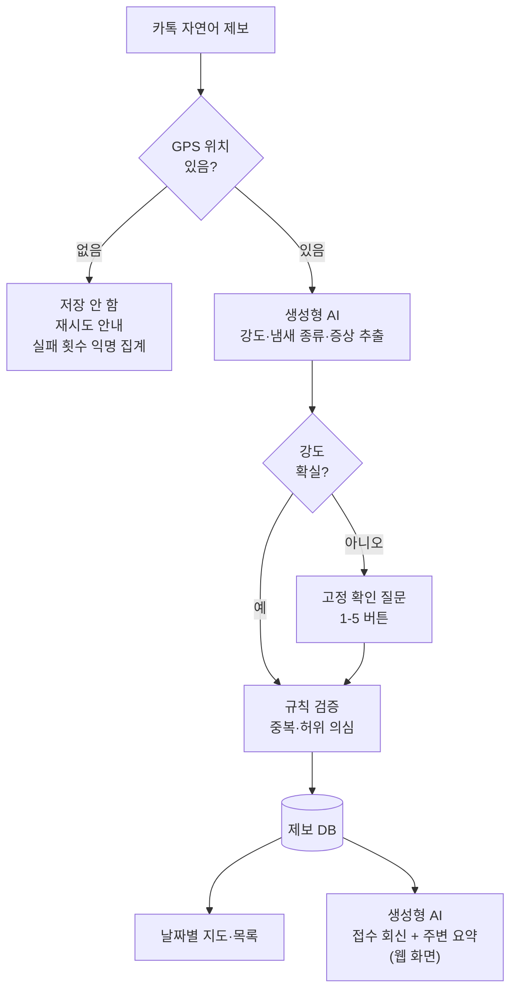

# 제주숨결봇(Jeju Breath Bot) 서비스 기획서

제주숨결봇(Jeju Breath Bot)은 카카오톡 한 문장으로 악취를 제보하면 날짜별 지도에 쌓이는 서비스입니다. 브레인스토밍에서 확정한 결정을 기준으로 작성했고, 숫자 기준 중 (가설) 표시는 PoC에서 확인합니다.

## 1. 문제 정의

**제주 악취 피해 지역 주민**은 **악취가 반복될 때마다** 언제·어디서·얼마나 심했는지 **한곳에 기록하거나 확인할 방법이 없어** 불편을 혼자 견디고 있으며, **카톡 한 문장으로 제보한 내용이 위치·시간·강도와 함께 지도에 쌓여 반복 발생 지역이 드러나기**를 바란다.

- 당사자: 악취로 불편을 겪는 제주 주민 (고령·스마트폰이 어려운 주민 포함)
- 상황: 평소엔 조용하다가 특정 날짜에 악취가 몰려 발생하고 여러 주민이 동시에 겪음
- 불편: 제보 창구가 번거롭고, 제보가 흩어져 반복 여부를 증명하기 어려움
- 기대 변화: 주민은 쉽게 남기고, 마을·기관은 날짜별 지도로 반복 지역을 확인

## 2. 서비스 파이프라인

입력 → 인식 → 생성형 AI → 검증 → 사용자 결과 순서입니다.

| 단계      | 입력 데이터                | 인식 도구 / AI 처리                                                       | 결과            |
| ------- | --------------------- | ------------------------------------------------------------------- | ------------- |
| ① 제보 수신 | 카톡 채널 메시지(자연어), 수신 시각 | 카카오톡 챗봇이 메시지 수신 후 \[위치 확인하고 제보하기\] 웹 링크 회신. 이후 단계는 모두 웹 화면에서 진행 | 원문 + 시각       |
| ② 위치 확인 | 스마트폰 GPS 좌표           | 좌표 유효성 검사(제주 범위·정확도). 없으면 저장하지 않고 재시도 안내, 실패 횟수만 익명 집계              | 확인된 좌표        |
| ③ 정보 추출 | 메시지 텍스트               | **생성형 AI**가 강도(1-5), 냄새 종류(양돈·계사·우사·퇴비·액비 등), 증상, 확신도를 JSON으로 추출    | 구조화된 제보       |
| ④ 확인 질문 | 강도 누락·확신도 낮음          | 고정 문구 "지금 냄새는 몇 단계인가요?" + 1-5 버튼 (AI 미사용)                      | 확정 강도         |
| ⑤ 검증·저장 | 좌표, 시각, 제보자 해시        | 규칙: 같은 제보자 30분·300m 내 재제보는 1건, 10분 내 5km 이동·1시간 5건 초과는 '확인 필요' (가설) | 제보 DB         |
| ⑥ 지도·통계 | 저장된 제보                | 지도 API, 날짜 필터, 강도 4-5 빨간색, 근사 위치(격자) 표시                             | 날짜별 지도·목록     |
| ⑦ 회신    | 저장 결과, 오늘 주변 제보 수     | **생성형 AI**가 접수 확인 + 주변 상황 한 줄 요약 작성                                 | 웹 접수 화면 + 지도 링크 |

### 강도 기준 (제주 주민참여형 악취모니터링 0-5도 준용)

0도(무취)는 제보할 냄새가 없는 상태이므로 서비스에서는 1-5단계만 씁니다.

| 단계  | 기준        | 주민 표현 예시     |
| --- | --------- | ------------ |
| 1   | 감지 취기     | 살짝 냄새나요      |
| 2   | 보통 취기     | 무슨 냄새인지 알겠어요 |
| 3   | 강한 취기     | 냄새가 확 나요     |
| 4   | 극심한 취기    | 창문 닫아야 해요    |
| 5   | 참기 어려운 취기 | 숨쉬기 힘들어요     |

### 생성형 AI 처리 예시

입력: "축사 냄새 때문에 창문을 못 열겠어요"

출력: {"강도": 4, "냄새 종류": "축사(양돈 추정)", "증상": ["창문 닫음"], "확신도": 0.8} → 확신도 0.7 이상이라 확인 질문 없이 저장

입력: "냄새가 납니다" → 강도 없음 → 회신: "지금 냄새는 1-5 중 몇 단계인가요?" [1] [2] [3] [4] [5]

## 3. 단계별 위험과 대응

| 단계      | 오류 가능성                | 데이터 편향                | 개인정보·안전              | 대응                                                             |
| ------- | --------------------- | --------------------- | -------------------- | -------------------------------------------------------------- |
| ② 위치    | 실내·권한 거부로 위치 실패       | GPS를 못 쓰는 고령 주민 제보 누락 | 정확한 집 위치 노출 위험       | 저장하지 않고 '야외에서 다시' 안내, 실패 횟수 익명 집계, 이장·가족 현장 대리 제보, 지도엔 근사 위치만  |
| ③ 추출    | 사투리·과장 표현을 잘못된 강도로 분류 | 표현이 강한 사람의 제보가 과대 반영  | 메시지에 이름·연락처가 섞일 수 있음 | 확신도 낮으면 확인 질문, 시연 전 평가용 20문장 분류 테스트(18개 이상 일치), 원문은 개인정보 마스킹 후 저장 |
| ④ 확인 질문 | 질문이 길어 제보 포기          | 디지털에 익숙한 주민만 완료       | -                    | 질문 1회 제한, 버튼 선택, 완료율 80% 미달 시 단계 축소                            |
| ⑤ 검증    | 정상 제보를 중복·허위로 오판      | 특정 마을 제보가 많아 그 지역만 부각 | 제보자 추적 우려            | 삭제 대신 '확인 필요' 표시, 제보자 ID는 해시 처리, 수작업 20건과 일치율 80% 확인           |
| ⑥ 지도    | 제보 0건을 '악취 없음'으로 오해   | 제보 참여가 많은 마을이 더 나빠 보임 | 특정 농가·사업장 낙인         | "제보 기준" 문구 표시, 사업장명 대신 지역 단위, 조치 결과도 함께 공개(기관 협의 후)            |
| ⑦ 회신    | AI가 근거 없는 원인·조치를 단정   | -                     | 잘못된 안내로 인한 분쟁        | 회신은 접수 사실과 주변 제보 수만, 원인 추정·법적 판단 문구 금지                         |

## 4. 범위

- **PoC에서 작동:** 카톡 제보 등록, GPS 확인, AI 강도 추출, 강도 확인 버튼(고정 질문), 날짜별 지도·목록, 웹 접수 회신
- **PoC 이후(데이터 축적·기관 협의):** 급증 알림, 시간대·지역 분석, AI 자동 신고, 기상·센서 데이터 연계, 처리 상태 공개(접수 → 확인 중 → 조치 완료)
- **하지 않음:** 주소·마을명 직접 입력, GPS 없는 제보 저장

## 5. 팀 역할 (제안, 팀 확정 필요)

| 담당           | 역할                                          |
| ------------ | ------------------------------------------- |
| 임세준          | 서비스 기획·강도 기준 확정, 시연 데이터 라벨링, 발표             |
| hunchul choi | 카톡 챗봇·Claude 추출 프롬프트·DB·지도 화면 개발, 시연 데이터 준비 |
| 공통           | 시연 리허설, PoC 지표 측정                           |

## 6. 시연 시나리오 (11/4, 약 3분)

1. 문제 소개: 평소엔 조용하다가 특정 날 악취가 몰리는 상황 (30초)
2. 주민 A가 "축사 냄새 때문에 창문을 못 열겠어요" 전송 → 위치 확인 링크 → 위치 허용 → 강도 4로 자동 기록 → 웹 화면에 접수 회신과 지도 링크
3. 주민 B가 "냄새가 납니다"만 전송 → 위치 허용 → 웹 화면에 1-5 버튼 확인 질문 → 3 선택 → 저장
4. 주민 C가 위치 권한을 거부해 GPS 실패 → 저장하지 않고 "위치 권한을 허용한 뒤 다시 시도해 주세요" 안내
5. 같은 날 미리 넣어 둔 시연 제보 20건과 함께 날짜별 지도 확인 → 강도 4-5 빨간색 구역이 한 마을에 몰린 모습
6. 마무리: PoC 지표(제보 완료율, GPS 허용률, 지도 열람률)와 다음 단계(기관 협의, 확장)

## 7. PoC 성공 지표

| 지표           | 목표 (가설)     | 측정               | 미달 시                         |
| ------------ | ----------- | ---------------- | ---------------------------- |
| 제보 완료율       | 시도 대비 80%   | 봇 로그             | 확인 질문 단계 축소                  |
| GPS 허용률      | 80% 이상      | 익명 실패 횟수 ÷ 제보 시도 | 저장 안 함 유지, 안내 문구 개선·대리 제보 안내 |
| 지도 열람률       | 회신 링크 50%   | 지도 접속 로그         | 접수 화면에 지도 미리보기 표시           |
| AI 강도 분류 정확도 | 평가용 20문장 중 18개 | 팀 수작업 분류와 비교     | 프롬프트 예시 보강, 버튼 질문 비중 확대      |

## 8. 데이터 계획 (수집 → 정제 → 라벨링 → 검증)

모델을 새로 학습하지 않고, 생성형 AI 프롬프트 예시와 평가에만 데이터를 씁니다.

| 단계  | 내용                                                                                                                | 수량·기준                                                    |
| --- | ----------------------------------------------------------------------------------------------------------------- | -------------------------------------------------------- |
| 수집  | ① 팀이 직접 작성한 주민 표현 문장(브레인스토밍 대화의 실제 표현 포함) ② 공개 강도 기준 문구(제주 주민참여형 악취모니터링 0-5도 설명, 출처 표기) ③ 시연용 위치 데이터는 애월 지역 가상 좌표 | 문장 60개: 강도 1-5 각 10개 + 강도 없음 10개 / 시연 제보 20건(가상 데이터로 표시) |
| 정제  | 이름·전화번호·상세 주소 마스킹, 같은 문장 중복 제거, 악취와 무관한 문장 제외, 욕설은 저장하되 회신에 인용하지 않음                                               | 개인정보가 남은 문장 0개                                           |
| 라벨링 | 팀원 2명이 각자 강도(1-5)·냄새 종류를 붙이고, 다르면 강도 기준표로 합의. 판단이 안 되면 '확인 질문 필요' 라벨                                              | 라벨 기준: 2장 강도 기준표                                         |
| 검증  | 60개를 40개(조정용)와 20개(평가용)로 분리. 조정용 중 5개는 프롬프트 예시로 넣고, 나머지 35개는 프롬프트를 고칠 때 시험용으로 사용. 평가용에서 AI 결과와 팀 라벨 비교                                                             | 강도 일치 18/20 이상, '확인 질문 필요' 문장은 모두 질문으로 처리                |

동의·라이선스: 실제 주민 개인정보는 PoC에서 수집하지 않음. 지도 API·Anthropic API 이용약관 확인(API 입력 데이터의 모델 학습 사용 여부 포함), API 키는 서버에만 보관. 실제 주민 제보 원문은 서비스 운영 전까지 수집하지 않음.

## 9. 주요 화면 구성

| 화면        | 제목·안내                      | 입력 요소      | 버튼                                               | 결과 표시                                |
| --------- | -------------------------- | ---------- | ------------------------------------------------ | ------------------------------------ |
| 카톡 제보     | "지금 느끼는 냄새를 한 문장으로 보내 주세요" | 자유 문장      | \[위치 확인하고 제보하기\]                                 | 위치 확인 페이지로 이동                        |
| 위치 확인 (웹) | "정확한 지도를 위해 현재 위치가 필요해요"   | 브라우저 위치 권한 | \[위치 허용\]                                        | 성공 시 AI 추출 후 강도 확인 또는 접수 화면, 실패(권한 거부 등) 시 오류 안내 |
| 강도 확인 (웹) | "지금 냄새는 몇 단계인가요?"          | 없음         | \[1 살짝\] \[2 보통\] \[3 강함\] \[4 극심\] \[5 참기 어려움\] | 선택한 강도로 저장                           |
| 접수 회신 (웹) | "제보가 접수됐어요"                | 없음         | \[오늘 지도 보기\]                                     | 시각·강도·오늘 주변 제보 수 한 줄                 |
| 오류 안내 (웹) | "위치를 확인하지 못해 저장하지 않았어요"    | 없음         | \[다시 시도\] \[가족·이장 대리 제보 방법\]                     | 위치 권한 허용 방법과 야외에서 다시 시도 안내                  |
| 지도·목록     | "날짜별 악취 제보 지도 (제보 기준)"     | 날짜 선택      | \[지도\] \[목록\] 전환                                 | 근사 위치 원, 강도 4-5 빨간색, 목록은 시각·강도·냄새 종류 |

## 10. 구현 방식과 기술 위험

| 구성          | 방식                                        | 위험과 대안                                                                                                    |
| ----------- | ----------------------------------------- | --------------------------------------------------------------------------------------------------------- |
| 제보 창구       | 카카오톡 채널 챗봇                                | 챗봇 메시지만으로는 기기 GPS를 바로 받기 어려울 수 있음 → 챗봇이 \[위치 확인\] 버튼으로 작은 웹 페이지를 열고 브라우저 위치 기능으로 좌표를 받음 (11/3 개발 시작 전 확인) |
| 정보 추출·회신 | Claude API (Claude Haiku 5.5), JSON 형식 출력. 확인 질문은 고정 문구 | API 장애·지연 시 강도 1-5 버튼 질문으로 바로 전환, 원문은 저장 후 나중에 재처리                                                        |
| 저장          | 간단한 DB(제보 테이블 1개 + 익명 실패 횟수 테이블 1개)       | 제보자 카톡 ID는 해시로만 저장                                                                                        |
| 지도          | 지도 API + 날짜 필터                            | 지도 로딩 실패 시 목록 화면으로 대체                                                                                     |

## 11. 현재 제보·확인 방식과 한계 (공개 자료 기준)

| 현재 방식                            | 입력 단계                              | 처리·확인              | 위치·반복 발생 확인의 한계                                      | 우리 서비스가 보완하는 점                       |
| -------------------------------- | ---------------------------------- | ------------------ | ---------------------------------------------------- | ------------------------------------ |
| 제주120 만덕콜센터 전화(064-120, 07\~22시) | 전화 연결 후 말로 설명                      | 콜센터 상담 후 관련 부서로 안내 | 위치·강도를 말로 전달, 다른 주민 제보와 한 지도에서 비교되지 않음               | GPS·시각·강도가 자동 기록되고 날짜별 지도에 쌓임        |
| 제주도 누리집 민원·환경신문고·안전신문고           | 회원 로그인·양식 작성                       | 부서 배정 후 회신         | 입력이 길어 악취가 날 때 바로 남기기 어려움, 제보 현황이 공개 지도로 보이지 않음      | 카톡 한 문장 + 버튼 1회로 완료                  |
| 제주악취관리센터 주민참여형 악취모니터링 앱          | 지정된 모니터링 요원이 정해진 시간대·장소에서 강도·취기 입력 | 센터가 집계해 보고서로 공개    | 요원(2025년 상반기 74명)과 지정 마을에 한정, 일반 주민이 원할 때 남기는 창구는 아님 | 누구나 악취가 날 때 제보, 같은 0-5도 기준(1-5단계)을 써서 비교 가능 |

배경: 제주 축산악취 민원은 2023년 1,998건, 2024년 2,494건, 2025년 2,687건으로 늘었지만, 밀집 지역에서는 바람에 따라 악취가 이동해 배출원 특정이 어렵다고 보도됐습니다(2026.10 보도). 위치·시각이 정확한 주민 제보가 쌓이면 기관의 현장 확인 시점과 장소를 정하는 데 참고 자료가 될 수 있습니다.

## 12. 사용 모델 (Claude API 확정)

| 적용 위치         | 모델                                                   | 입력                     | 출력                                        | 선택 이유                                                                                | 검증·전환 규칙                                           |
| ------------- | ---------------------------------------------------- | ---------------------- | ----------------------------------------- | ------------------------------------------------------------------------------------ | -------------------------------------------------- |
| ③ 강도·냄새 종류 추출 | Claude Haiku 5.5 (Anthropic API, 도구 호출로 JSON 스키마 지정) | 제보 문장 + 강도 기준표 + 예시 5개 | JSON {강도 1-5 또는 null, 냄새 종류, 증상, 확신도 0-1} | 팀이 Claude API 사용으로 결정. 한국어 처리, Claude 모델 중 응답이 빠르고 저렴해 제보마다 호출하기 적합, 도구 호출로 출력 형식 고정 | 스키마 불일치·강도 범위 밖이면 1회 재시도, 다시 실패하면 버튼 질문            |
| ④ 확인 질문       | AI 미사용 (고정 문구)                                    | ③ 추출 결과(강도·확신도)        | "지금 냄새는 몇 단계인가요?" + 1-5 버튼            | 질문이 매번 같아 고령 주민이 익숙해지기 쉽고, AI 호출이 줄어 응답이 빠름                                   | 확신도 0.7 미만이거나 강도 null이면 질문, 질문은 1회만, 이후 버튼 선택으로 확정 |
| ⑦ 접수 회신       | Claude Haiku 5.5                                     | 저장 결과, 오늘 주변 제보 수      | 회신 2문장 이내                                 | 상황에 맞는 짧은 안내                                                                         | 원인 추정·법적 판단 단어 포함 시 고정 문구로 대체, API 장애 시 고정 문구      |
| 위치·중복·허위 판정   | AI 미사용 (규칙)                                          | 좌표, 시각, 제보자 해시         | 저장 여부, '확인 필요' 표시                         | 판단 근거를 설명할 수 있어야 함                                                                   | 2장 ⑤ 규칙 그대로                                        |

## 13. 왜 AI가 필요한가

주민 표현은 "냄새가 확 올라와요", "돼지 냄새 때문에 숨 막혀요", "창문 다 닫았어요"처럼 사투리·비유·증상이 섞여 있어 고정 키워드 규칙만으로는 강도와 냄새 종류를 안정적으로 구조화하기 어렵습니다. 그렇다고 처음부터 버튼만 쓰면 주민이 직접 쓰고 싶은 상황 설명(증상, 냄새 종류)이 빠집니다. 그래서 자연어는 AI가 구조화하고, AI가 확신하지 못할 때만 버튼으로 확인하는 방식을 씁니다.

| 방식            | 장점                | 한계                             | 판단                          |
| ------------- | ----------------- | ------------------------------ | --------------------------- |
| 키워드 규칙        | 빠르고 설명 가능         | "숨 막혀요"·"창문 닫았어요" 같은 간접 표현을 놓침 | 위치·중복 판정에만 사용               |
| 버튼만           | 정확, 고령 주민도 쉬움     | 증상·냄새 종류·상황 설명이 빠짐             | AI 확신도가 낮을 때 보조로 사용         |
| AI 추출 + 버튼 확인 | 자유롭게 쓰고 필요할 때만 확인 | AI 오분류 가능                      | 채택. 평가용 20문장에서 18개 이상 일치 확인 |

## 14. 접근성 설계

| 화면    | 접근성 요소                                                         | 확인 방법                             |
| ----- | -------------------------------------------------------------- | --------------------------------- |
| 위치 확인 | 큰 글씨(18pt 이상)와 그림으로 "위치 허용" 버튼 위치 안내, 한 화면에 한 단계만 표시, 버튼 1개    | 리허설에서 처음 보는 사람이 도움 없이 허용까지 가는지 확인 |
| 강도 확인 | 숫자와 말을 함께 쓴 큰 버튼 5개(1 살짝 \~ 5 참기 어려움), 색 대신 글자로 구분             | 버튼 선택에 걸린 시간 기록                   |
| 오류 안내 | "밖으로 나가서 다시 눌러 주세요"처럼 행동 하나만 안내, \[가족·이장에게 부탁하기\] 버튼           | 실패 후 재시도 성공률                      |
| 지도    | 큰 글자 범례(빨강 = 4-5단계), 색만으로 구분하지 않도록 강도 숫자 함께 표시, \[목록으로 보기\] 전환 | 범례 없이도 오늘 심한 지역을 찾는지 확인           |

## 15. 대표 페르소나 (가상)

**김순자(67세), 애월읍 양돈장 인근 마을 거주.** 카카오톡으로 자녀와 사진을 주고받을 정도로 쓰지만 앱 설치나 위치 권한 설정은 자녀에게 부탁합니다. 저녁 무렵 악취가 심해지면 창문을 닫고 참거나 이웃과 이야기만 하고, 전화 민원은 무엇을 말해야 할지 몰라 거의 하지 않습니다. 이 서비스로 "오늘 냄새가 심했다"는 사실을 쉽게 남기고, 우리 마을만 겪는 일이 아니라는 것을 지도에서 확인하는 것이 목표입니다. 문제 정의의 당사자(악취 피해 주민, 고령·스마트폰이 어려운 주민 포함)와 같은 사람입니다.

## 16. PoC 기능 우선순위

| 우선순위         | 기능                                                                      | 이유                                |
| ------------ | ----------------------------------------------------------------------- | --------------------------------- |
| P0 (시연 필수)   | 카톡 제보 수신, 위치 확인(GPS 없으면 저장 안 함 + 안내), AI 강도 추출, 강도 확인 버튼, 저장, 날짜별 지도·목록 | 문제 해결의 최소 흐름, 하나라도 빠지면 시연 불가      |
| P1 (시간이 남으면) | AI 접수 회신 문구 개선, 중복·허위 '확인 필요' 표시, GPS 실패 익명 집계 화면, 접근성 요소(큰 글씨 안내·범례)   | 신뢰도·사용성을 높이지만 고정 문구·기본 화면으로 대체 가능 |
| P2 (이후)      | 처리 상태 공개, 급증 알림, 지역 분석, AI 자동 신고, 기상·센서 연계, 대리 제보 전용 흐름                 | 데이터 축적·기관 협의가 먼저 필요               |

## 17. 일정과 역할별 마감 (해커톤 11/3\~11/4)

| 시점      | 임세준 (제안)                   | hunchul choi (제안)                                     | 완료 기준                            |
| ------- | -------------------------- | ----------------------------------------------------- | -------------------------------- |
| 11/3 저녁 | 강도 기준 문구 확정, 평가용 문장 60개 작성 | 카톡 챗봇 수신과 웹 위치 확인 연동 시험, 실패 시 비상안 준비                  | 챗봇에서 좌표가 저장되는 것 1회 확인, 문장 60개 완성 |
| 11/4 오전 | 평가용 20문장 라벨링, 시연 시나리오 대본   | Claude API 키 발급·호출 시험, AI 추출·강도 확인 버튼·DB·지도 통합, 오류 안내 흐름 | P0 흐름 처음부터 끝까지 3회 연속 성공          |
| 11/4 오후 | 발표 자료, 리허설 진행              | P1 반영, 비상안 시험, 시연 데이터 20건 입력                          | 리허설 2회, 비상안 전환 1회 시험             |

## 18. 시연 비상안 (P0)

| 문제               | 비상안                                                                | 사전 시험               |
| ---------------- | ------------------------------------------------------------------ | ------------------- |
| 웹 위치 연동 실패       | '시연 모드'로 미리 정한 애월 테스트 좌표를 사용 (화면에 "시연 모드: 테스트 좌표" 표시, 실서비스에서는 비활성) | 11/4 오후 리허설에서 전환 1회 |
| Claude API 장애·지연 | 강도 1-5 버튼 기반 제보로 즉시 전환, 회신은 고정 문구                                  | API 키를 일부러 끊고 1회 시험 |
| 카톡 챗봇 연결 실패      | 같은 흐름의 웹 제보 화면으로 시연                                                | 리허설에서 1회            |
| 지도 로딩 실패         | 목록 화면 + 미리 캡처한 지도 이미지                                              | 캡처 준비               |

## 19. 데이터 보관·삭제 기준 (실서비스 운영 기준)

PoC에서는 팀이 작성한 가상 문장과 가상 좌표만 씁니다. 아래 표는 실서비스를 운영할 때의 기준이며, PoC 데이터는 마지막 줄 기준을 따릅니다.

| 데이터         | 보관 형태                       | 보관 기간                | 삭제 방식                                 |
| ----------- | --------------------------- | -------------------- | ------------------------------------- |
| 제보 원문       | 수신 즉시 이름·연락처·상세 주소 마스킹 후 저장 | 30일 (AI 재처리·오분류 확인용) | 30일 지나면 원문 삭제, 추출 결과(강도·냄새 종류·증상)만 유지 |
| GPS 원좌표     | 중복·허위 판정에만 사용               | 판정 직후(최대 24시간)       | 격자(근사 위치)로 바꾼 뒤 원좌표 삭제                |
| 근사 위치·시각·강도 | 지도·통계용                      | 서비스 운영 기간            | 운영 종료 시 일괄 삭제 또는 기관에 익명 통계로만 이관       |
| 제보자 해시      | 중복 판정용, 카톡 ID 원본은 저장하지 않음   | 서비스 운영 기간            | 운영 종료 시 일괄 삭제                         |
| GPS 실패 횟수   | 날짜별 숫자만                     | 서비스 운영 기간            | 개인 식별 정보가 없어 통계로 유지                   |
| PoC 시연 데이터  | 가상 좌표·팀 작성 문장               | 해커톤 종료 후 1주          | DB 전체 삭제                              |

## 20. 출처 (확인일 2026-11-03)

- 제주특별자치도, "민원신청/신고센터" 누리집 (제주120 만덕콜센터 064-120 운영 시간, 환경신문고·안전신문고 안내) https://www.jeju.go.kr/online.htm
- 제주악취관리센터, "주민참여형 악취모니터링" 소개 페이지 https://www.jomc.co.kr/monitoring/citizen
- 제주악취관리센터, "2021년 주민참여형 악취모니터링 시스템 운영 결과보고서" (냄새 강도 0-5도 입력 기준, 냄새 취기 구분) https://www.jomc.co.kr/community/download/1239
- 한라일보, "제주 서부, 아침·저녁으로 양돈냄새로 시달린다" (2025.08.11, 2025년 상반기 모니터링 요원 74명)
- 연합뉴스, "\[줌in제주\] 냄새에 이름표라도…잡힐 듯 안 잡히는 양돈장 악취" (2026.10.18, 축산악취 민원 2023\~2025년 건수, 배출원 특정 어려움)
- 뉴스1(파이낸셜뉴스 게재), "제주 악취관리지역 양돈장 절반 기준 초과…행정처분은 '난감'" (2026.10.14)

